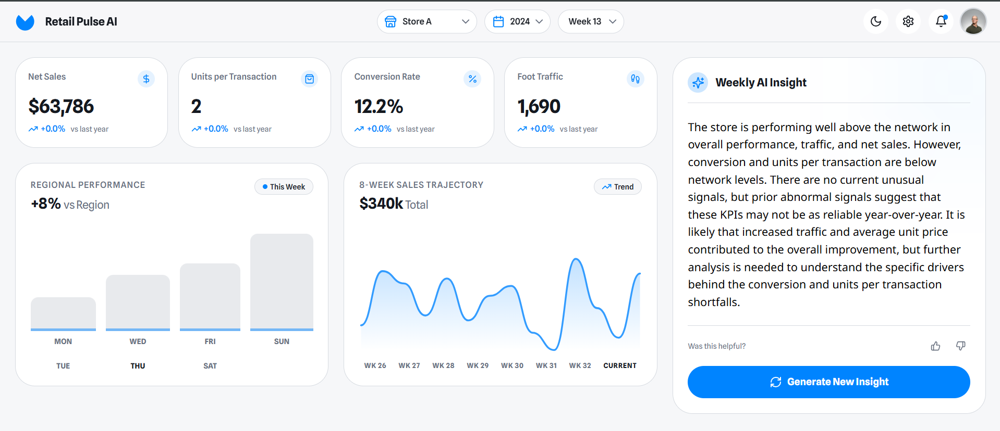
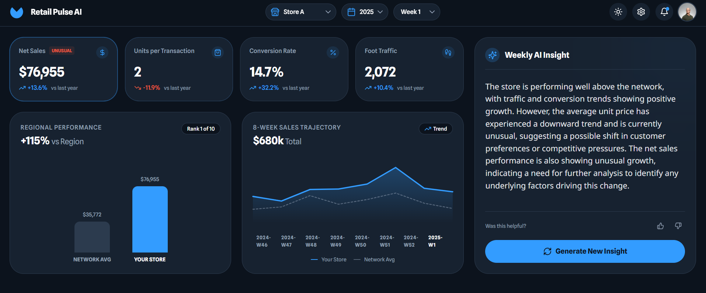
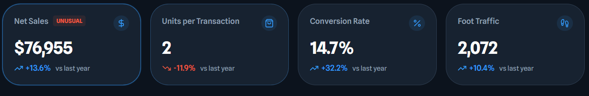

# 🏬 Retail Pulse AI — Store Performance Insights

Retail Pulse AI is a prototype dashboard that delivers **weekly, explainable performance insights** for retail store managers.
It combines **deterministic analytics** with **LLM-generated explanations**, while explicitly preventing **client-confidential data leakage**.

---

## ✨ Key Features

- 📊 Weekly store KPIs and sales drivers
- 🧠 AI-generated executive insight (3–5 lines)
- 🏪 Store vs network (regional) performance comparison (Ready)
- 📈 8-week sales trajectory with year-boundary handling (Ready)
- 🔒 Privacy-safe LLM usage (no raw data sent) 
- 🌗 Light / Dark mode toggle
- ⚡ FastAPI backend + React frontend

---

## 🧱 Project Structure

Retail-Pulse-AI/
├── backend/
│   ├── main.py
│   ├── data_loader.py
│   ├── analytics_service.py
│   ├── kpi_processing.py
│   ├── llm_service.py
│   ├── schemas.py
│   ├── requirements.txt
│   ├── .env
│   └── data/
│       └── practical-test-dataset-weekly-kpi.xlsx   # REQUIRED: place the data file here
│
├── frontend/
│   ├── src/
│   │   ├── components/
│   │   ├── api.ts
│   │   ├── App.tsx
│   │   └── main.tsx
│   ├── index.html
│   ├── package.json
│   └── vite.config.ts
│   └── more ....
│
├── docs/
│   └── screenshots/
│       ├── dashboard-light.png
│       ├── dashboard-dark.png
│       └── ai-insight.png
│
└── README.md


---

## 📂 Data Setup (IMPORTANT)

The backend expects the dataset to be placed in the following folder:

```
backend/data/
```

The file must be named: `practical-test-dataset-weekly-kpi.xlsx`


The Excel file must contain at least the following columns:

- Store Name
- Year
- Week
- traffic
- gross_transactions
- gross_quantity
- net_sales

⚠️ If the file is missing or placed elsewhere, the backend will fail at startup.

---

## 🔧 Backend — Setup & Run

### Prerequisites
- Python 3.10+
- pip

### Create and activate virtual environment

```
cd backend
python -m venv .venv
```


**Windows**
```
.venv\Scripts\activate

or

.venv\Scripts\Activate.ps1
```

**macOS / Linux**
```
source .venv/bin/activate
```


### Install dependencies

```
pip install --upgrade pip
pip install -r requirements.txt
```


### Environment variables

Create `backend/.env`:

```
OPENAI_API_KEY=sk-xxxxxxxxxxxxxxxxxxxx
SABANOVA_API_KEY=xxxxxxxxxxxxxxxxxxx
MODEL_NAME=xxxxxxxxxxxxxxxxxx
```

add OPENAI_API_KEY/SABANOVA_API_KEY api key and MODEL_NAME


> Never commit this file.

### Run backend

```
uvicorn main:app --reload
```

Backend:
```
http://127.0.0.1:8000/
```


Swagger:
```
http://127.0.0.1:8000/docs
```


---

## 🎨 Frontend — Setup & Run

### Prerequisites
- Node.js 18+
- npm

### Install dependencies

```
cd frontend
npm i
```


### Run frontend

```
npm run dev
```

Frontend:
```
http://localhost:8080/
```


---

## 🔁 Application Flow

1. Frontend loads → `/api/metadata`
2. User selects store / year / week
3. Frontend calls:
   - `/api/insight`
   - `/api/regional-performance`
   - `/api/sales-trajectory`
4. KPIs, charts, and AI insight update

---

## 🔒 AI & Privacy Design

- No raw sales values sent to the LLM
- No store identifiers sent
- No ranks or exact percentages sent

The LLM only receives:
- Relative performance buckets
- Directional trends
- Boolean anomaly flags

The LLM is used strictly as an **explanation layer**.

---

## 📸 Screenshots

Screenshots added under `docs/screenshots/`:

Dashboard Light Mode:



Dashboard Dark Mode:



Unusual KPI flaged (example: unusual sales):



